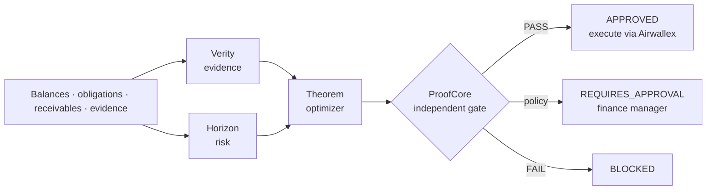

# VENTHORA

**Every financial decision, proven before execution.**

VENTHORA is an autonomous treasury agent for cross-border businesses, built on Airwallex. It decides which obligations to pay, convert for, defer or escalate when cash is limited. Before it acts, an independent verification gate proves that the action respects the reserve floor, company policy and the live bank state.

> Airwallex Agentic Banking Hackathon 2026 · Track **Treasury & Ops** · Starter Kit 01 **Adaptive Treasury Controller**

---

## The problem

A finance team holds USD and owes payroll, a SWIFT supplier in EUR and a vendor in GBP within the next 72 hours. A customer receipt they were counting on just slipped. Today someone re-runs a spreadsheet, guesses at FX, and hopes nothing gets paid twice.

Most AI agents can *recommend* a payment. VENTHORA verifies the evidence, quantifies the uncertainty, proves the action meets financial constraints, executes it through Airwallex, and verifies the outcome.

## How it works



| Engine | Answers | How |
|---|---|---|
| **Verity** | Which obligations are backed by trustworthy evidence? | Matches every obligation to its document; rejects settled records, unverified evidence and duplicate invoice fingerprints |
| **Horizon** | What could change before money moves? | Stress buffer from scenarios plus optional empirical FX stress (p95 adverse 5-day move from ECB history); classifies receipts as reliable or not |
| **Theorem** | What is the best feasible plan? | Exact integer optimization (OR-Tools CP-SAT, or exact enumeration) with strict priority, FX conversion cost and SWIFT fees; defers when a reliable receipt lands first, otherwise escalates |
| **ProofCore** | Is this action safe to execute? | Recomputes post-action balances independently, then checks invariants, policy (local and OPA, which must agree), live Airwallex balances and the TigerBeetle ledger. Any failure blocks |

**Design rule (following the organizers' guidance):** amounts, limits, reserves, duplicate protection and state transitions live in code. The model reads unstructured text, compares evidence and explains. It never sets an amount or holds credentials.

## Demo: the Kit 01 story

Two scenarios ship in [`data/scenarios`](data/scenarios). They cover the same company: USD 20,000 cash, a USD 5,000 reserve floor, and five obligations in three currencies.

**1 · Baseline → `APPROVED`**

```text
Convert USD 4,353.95 -> EUR 4,012.85            (EUR 4,000 + EUR 12.85 SWIFT fee @ 1.0850)
Pay            PAYROLL-USD         USD 8,000.00
Convert & pay  SUPPLIER-EU         EUR 4,000.00
Reject         SUPPLIER-EU-RESENT  EUR 4,000.00  duplicate of SUPPLIER-EU (same invoice fingerprint)
Defer          VENDOR-UK           GBP 3,000.00  reliable receipt RCV-ACME lands before due
Pay            SAAS-USD            USD 1,200.00
USD balance after plan USD 6,446.05 vs required floor USD 6,000.00
```

**2 · New information: the customer emails that payment slips five days → `REQUIRES_APPROVAL`**

Forecast confidence drops from 90% to 40%. The autonomous conversion limit tightens from USD 5,000 to USD 2,500. VENDOR-UK can no longer be safely deferred, so the agent **escalates it to a finance manager** instead of guessing.

## Quick start

Requires Python 3.11+.

```bash
python -m venv .venv
.venv/Scripts/python -m pip install -e ".[dev,solver]"     # Windows
# source .venv/bin/activate && pip install -e ".[dev,solver]"   # macOS/Linux
uvicorn venthora.api:app --reload
```

Open http://127.0.0.1:8000/docs and call `POST /api/scenarios/kit01_baseline/plan`, then `POST /api/scenarios/kit01_receipt_delayed/plan`.

With Docker (includes a real OPA sidecar):

```bash
docker compose up --build
```

### Connect Airwallex sandbox

```bash
cp .env.example .env    # then fill AIRWALLEX_CLIENT_ID and AIRWALLEX_API_KEY (sandbox keys only)
```

With credentials set, ProofCore cross-checks every plan against live sandbox balances (`GET /api/v1/balances/current`). `GET /api/airwallex/balances` shows them.

### Optional authorities

| Variable | Effect |
|---|---|
| `OPA_URL` | Policy is evaluated in OPA as well; any disagreement with local policy blocks |
| `TB_ADDRESS`, `TB_ACCOUNT_ID` | TigerBeetle ledger balance must also cover the plan (`pip install -e ".[ledger]"`) |
| `VENTHORA_NATIVE_LIB` | C++17 reserve gate ([`native/money_gate.cpp`](native/money_gate.cpp)) runs alongside Python |
| `VENTHORA_*_URL` | Plug in external Verity/Horizon/Theorem engines. They can only narrow what local checks allow ([contracts](docs/ENGINE_CONTRACTS.md)) |

Real FX stress: `python scripts/import_ecb.py`, then send `"use_ecb_stress": true`.

## API

| Method | Path | Purpose |
|---|---|---|
| `GET` | `/api/scenarios` | List demo scenarios |
| `POST` | `/api/scenarios/{id}/plan` | Plan a bundled scenario |
| `POST` | `/v1/plans` | Plan any `TreasuryState` |
| `GET` | `/api/audit` | Hash-chained decision log + integrity check |
| `GET` | `/api/status` | Solver and connected authorities |
| `GET` | `/api/airwallex/balances` | Live sandbox balances |

## Tests

```bash
pytest -q
ruff check src tests scripts
```

The 56 tests cover the full Kit 01 flow, duplicate-payment defense, remote engines that try to approve rejected invoices, fail-closed behavior, 40 randomized states that must never breach the reserve, CP-SAT vs exact-solver agreement, the Airwallex auth/balance client, and audit-chain tamper detection.

## Project structure

```text
src/venthora/
  domain/        typed state, integer money, post-action projection
  engines/       verity, horizon, theorem, remote adapters
  proofcore/     independent gate + policy (mirrored in policy/treasury.rego)
  gateways/      Airwallex, OPA, TigerBeetle, native C++ gate
  orchestrator.py  the agent loop
  api.py         FastAPI app
data/scenarios/  Kit 01 demo scenarios
docs/            architecture, hackathon compliance, demo script
```

## Roadmap to submission (13 Nov 2026)

- [ ] Airwallex execution tools: FX quote → conversion → transfer, single-use quotes, persisted `request_id`
- [ ] Sandbox simulation: deposit + transfer transition; post-execution reconciliation
- [ ] LLM evidence reader: turns the customer's delay email into a typed receivable update
- [ ] Human approval endpoint for `REQUIRES_APPROVAL` plans
- [ ] Treasury dashboard for the demo video

Status against the organizers' criteria: [docs/HACKATHON_COMPLIANCE.md](docs/HACKATHON_COMPLIANCE.md).

## License

MIT. See [LICENSE](LICENSE).
