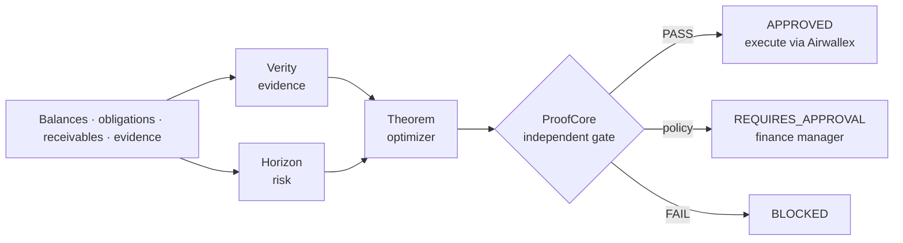
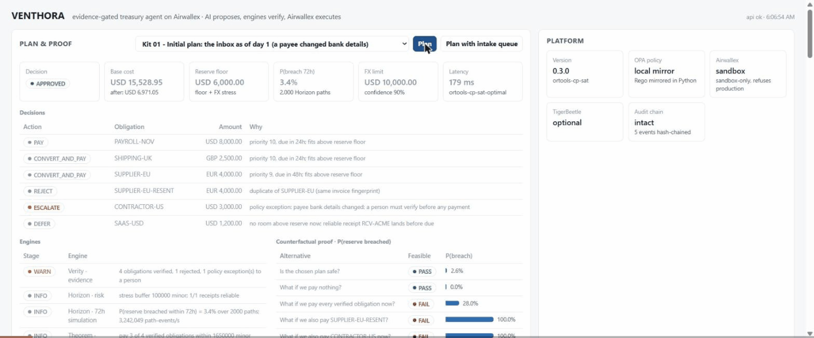

# VENTHORA

**Every financial decision, proven before execution.**

VENTHORA is an autonomous treasury agent for cross-border businesses, built on Airwallex. It decides which obligations to pay, convert for, defer or escalate when cash is limited. Before it acts, an independent verification gate proves that the action respects the reserve floor, company policy and the live bank state.

> Airwallex Agentic Banking Hackathon 2026 · Track **Treasury & Ops** · Starter Kit 01 **Adaptive Treasury Controller**

**Live demo:** https://app-venthora.muwahid.org (the Airwallex sandbox; no real money moves). Run it yourself: [Quick start](#quick-start). Menu by menu: [How to Use VENTHORA](docs/WALKTHROUGH.md).

### On the screen for Kit 01

- **Agent plan → Today's plan**: every payment due in the next 72 hours in one line-up, High priority first, against the cash above the
  reserve floor. Green: the cash covers it. Yellow: the last one it covers. Blue line: the reserve floor. Red: waits, whatever its
  level, because the line is never crossed to pay a cheaper, lower one. Payments beyond the twelve one plan proves wait for the next round.
- **Autopilot Console**: the Kit 01 checklist read from the live plan (currencies, partial cover, the critical supplier, the minimum
  conversion, the deferral, the escalation, the forecast-based limit, the re-plan after a deposit), then the five-step run.
- **Pending payment → Review**: one form per request with the checks and their evidence, the PO and what is left on it, the emails sent
  to the vendor and to the FCO (date, result, text), the vendor's other submissions, and a call sheet for the call-back.
- **Timing**: invoices and bills are paid at the daily run (11:59 UTC here), so a person can change course each day; payroll and benefits
  on their pay date from 00:30 UTC.

### Sponsors: what is live, what is a demo, what waits for access

| Sponsor | In VENTHORA | Status |
|---|---|---|
| **Airwallex** | Balances, FX quotes and conversions, beneficiaries (schema, validation, name check), transfers, deposits, webhooks | **Live on the sandbox.** Every payment in the demo moves through it. Account opening and cards depend on what Airwallex has enabled for the sandbox account |
| **Alta** | The audit-log head and every contract chain head anchored in one transaction (Platform Setup → Blockchain Record) | **Live on Alta Testnet** on the staging server since 16 Nov 2026 (the anchoring rule wrote its first transaction there the same night); test tokens only, money never moves on Alta |
| **Xendit** | The holder's name of an Indonesian account before it is paid; payouts to Indonesian e-wallets (Platform Setup → Local Rails) | Sandbox. Without a Xendit key the name check answers as *simulated* and says so |
| **Midtrans** | The connection (sandbox keys) and the list of rupiah collection products: QRIS, virtual accounts, cash at stores | **Connection only.** The products are marked *planned* on the page and collect nothing yet |
| **Visa** | Agent Identity (TAP), Intelligent Commerce, the virtual card report, *Compare with Visa's daily rate* | **Sandbox calls live** on the staging server since 16 Nov 2026: Visa's connectivity check, Foreign Exchange Rates and Supplier Matching answer from Visa's sandbox (test data, said on the page). Agent Identity and Intelligent Commerce stay under *Developer · demo mode*; no card is charged |
| **AWS** | The live demo runs on EC2; Amazon Bedrock is one of the model providers under Platform Setup → Agent | Hosting is live; Bedrock is a selectable provider |
| **Airwallex MCP** | A page under *Developer · demo mode* | **Not used for money.** VENTHORA calls REST behind typed methods, which the guide allows |

A page that is a demo or planned says so on the screen; nothing here is presented as more than it is.

---

## The problem

A finance team holds USD and owes payroll, a SWIFT supplier in EUR and a vendor in GBP within the next 72 hours. A customer receipt they were counting on just slipped. Today someone re-runs a spreadsheet, guesses at FX, and hopes nothing gets paid twice.

Most AI agents can *recommend* a payment. VENTHORA verifies the evidence, quantifies the uncertainty, proves the action meets financial constraints, executes it through Airwallex, and verifies the outcome.

## How it works



| Engine | Answers | How |
|---|---|---|
| **Verity** | Which obligations and receipts are backed by trustworthy evidence? | Matches every obligation to its document and rejects settled records, unverified evidence and duplicate invoice fingerprints. A language model reads the inbox; the original Verity corpus, BM25 retriever and citation validator decide whether its claim is cited and pre-embargo |
| **Horizon** | What could change before money moves? | The original Horizon M0 scenario engine draws seeded joint EUR/USD and GBP/USD paths from ECB history; the p95 adverse 3-business-day move becomes the FX stress buffer. It also classifies receipts as reliable or not |
| **Theorem** | What is the best feasible plan? | Exact integer optimization (OR-Tools CP-SAT, or exact enumeration) with strict priority, FX conversion cost and SWIFT fees. It defers when a reliable receipt lands first and escalates otherwise. The original Theorem quant toolkit independently nets every conversion leg |
| **ProofCore** | Is this action safe to execute? | Recomputes post-action balances independently, then checks invariants, policy (local and OPA, which must agree), live Airwallex balances and the TigerBeetle ledger. Any failure blocks. This is SeismoForge's evidence-gate pattern, applied to finance |

The original engines are vendored unmodified, with SHA-256 provenance and a test that fails if they change: [`src/venthora/originals/PROVENANCE.md`](src/venthora/originals/PROVENANCE.md).

**Design rule (following the organizers' guidance):** amounts, limits, reserves, duplicate protection and state transitions live in code. The model reads unstructured text, compares evidence and explains. It never sets an amount or holds credentials.

## Demo: the Kit 01 story



**Live on the sandbox.** `python scripts/demo_server.py --reset`, then open `http://localhost:8001/live`: the finance manager grants the mandate on one form (every permission, safeguard, budget line, approver, payee and the reporting cut-off; unchecking a permission revokes it), then the builder guide's five demo elements run one button at a time on a USD 30,000 book with a USD 10,000 floor, with the Airwallex wallet polled live beside it. Every step really runs: the inbox is read, the plan is proven, a deposit settles on Airwallex, and the payments execute and reconcile to the cent.

**The Control center** (`http://localhost:8001/`) opens on an overview that holds only charts and notifications:
- the live Airwallex wallet,
- payment activity,
- budget used per line,
- allocation per unit,
- execution outcomes and payee status,
- a feed of what needs a person, pushed live from Airwallex webhooks.

The top row is the treasury position (`GET /v1/treasury/position`). Each tile has its own source:

| Tile | Source |
|---|---|
| **Available balance** | Airwallex `available_amount` per currency: the old balance, plus settled deposits, plus received payments. Transfers Airwallex has not finished show in brackets (`… processing, already out`). Airwallex takes a transfer out of the available balance when it is created (checked on the sandbox), so it is shown, not subtracted again. |
| **Bills to pay** | Invoices in the queue that are not paid yet, split into ready to pay and waiting for a person. They will reduce the balance. |
| **Pending deposits** | Deposits Airwallex holds as `PENDING` from anyone who is not a registered customer, such as a top-up from the company's own bank. |
| **Incoming payments, not cleared** | `PENDING` deposits from registered customers, plus customer remittances that were announced but have not arrived. |
| **Outlook** | Available − bills + pending deposits + incoming. This is an outlook, not spendable money. |

`python scripts/demo_review_cases.py --to https://<tunnel-host> --processing --approve` fills every tile on the real
sandbox. It sends eleven emails through the inbound mail webhook and judges each outcome against the tests'
expectations (`tests/test_review_cases.py`). Of the eleven:
- two clean invoices become bills ready to pay;
- seven stop for a person, each for a reason quoted from the email or PDF: no PO, more than the PO has left, an amount
  that is no term, totals that do not add up, new bank details, pressure to pay today, and a staff travel claim;
- one customer announces a payment;
- one forged email is quarantined.

The runner then pays what is ready on the live-grounded intake-only book
(`GET /v1/intake/state/intake_only?live=true`) and leaves the transfers in flight, so the tiles show processing.
Last run (29 Oct 2026): 11 of 11 as expected; 4 transfers processing (USD 5,050 and GBP 450); 5 bills waiting for a
person (USD 24,193.72); USD 6,500 announced, not yet arrived.

Amounts are converted to the base currency at Airwallex's indicative rates, and a currency without a rate is named,
not guessed. Airwallex is read at most every 20 s, and a webhook or new email clears that cache, so the row updates the
moment a status changes.

The vertical menu holds everything else:
- Payment: agent plan, intake, commitment, pending payment, balance received, budget allocation, executions & incidents (with run reports).
- Procurement Process: vendor sourcing and quotation.
- Reporting: ten spending reports, Total Spending, books & ledger, period close.
- Users & Beneficiaries: Head Quarter, country offices, branch offices and project finance units, people and roles, vendors, customers, payee lifecycle.
- Platform Setup and System Setting: the Airwallex account, the AI model, integrations, unit prices, finance standards, Delegation of Authority, webhooks, and checks & resilience.

**Recording the demo.** `http://localhost:8001/flow` is an animated map of the workflow for the video's opening.
`python scripts/record_demo.py` records the dashboard part by itself: Microsoft Edge at 1920x1080 runs the operations
page on the real sandbox and then the Control center, writes `demo_video/dashboard.webm` with a cue log, and rejects a
take in which the sandbox did not settle the deposit or pay all four transfers. The voice-over for the recorded take
is [`docs/DEMO_VOICEOVER_3MIN.md`](docs/DEMO_VOICEOVER_3MIN.md). [`docs/DEMO_STORYBOARD.md`](docs/DEMO_STORYBOARD.md) is the nine-scene storyboard, plus a procurement step (what to click, what appears, timing) and [`docs/DEMO_SCRIPT.md`](docs/DEMO_SCRIPT.md) the word-for-word narration, timed to about five minutes. `python scripts/demo_server.py --reset` serves the dashboard on clean stores at `http://localhost:8001`; `python scripts/demo_walkthrough.py` performs every scene through the dashboard's own endpoints on the real sandbox and prints the narration cues (last run: [`docs/demo_run_log.json`](docs/demo_run_log.json)).

The setting is a USD 22,500 treasury allocation with a USD 5,000 reserve floor. Five obligations in USD, EUR and GBP fall due within 72 hours ([`data/scenarios/kit01_baseline.json`](data/scenarios/kit01_baseline.json)), plus an inbox ([`data/inbox/kit01_inbox.json`](data/inbox/kit01_inbox.json)). The two later states are **generated by reading the inbox** (`scripts/make_scenarios.py`), not written by hand.

**1 · Day 1, initial plan (`kit01_initial`) → `APPROVED` autonomously.** Every Kit 01 behaviour appears in this one plan:

```text
Convert USD 4,353.95 -> EUR 4,012.85   minimum for the time-sensitive supplier (EUR 4,000 + 12.85 SWIFT fee)
Convert USD 3,175.00 -> GBP 2,500.00
Pay            PAYROLL-NOV         USD 8,000.00
Convert & pay  SHIPPING-UK         GBP 2,500.00  shipping invoice: non-payment halts operations
Convert & pay  SUPPLIER-EU         EUR 4,000.00
Reject         SUPPLIER-EU-RESENT  EUR 4,000.00  duplicate of SUPPLIER-EU (same invoice fingerprint)
Escalate       CONTRACTOR-US       USD 3,000.00  policy exception: payee bank details changed (cited email)
Defer          SAAS-USD            USD 1,200.00  cheapest obligation; reliable receipt RCV-ACME lands first
Autonomous FX limit USD 10,000 at forecast confidence 90%; conversions USD 7,528.95
```

**2 · Day 2, the customer emails that payment slips five days (`kit01_receipt_delayed`) → `REQUIRES_APPROVAL`.**
- Confidence is calibrated from the payer's history: Acme kept 6 of 8 promises counting this delay, so confidence goes from 90% to **70%**, with a 90% arrival window of 144–290 h.
- The autonomous limit scales with confidence (full at ≥90%, zero at ≤50%) and falls to USD 5,000. The **same conversion** now needs a finance manager.
- Only SAAS-USD changes (DEFER → ESCALATE); the other decisions stay locked.

**3 · The deposit lands (Airwallex `SETTLED`) → `APPROVED`.** Only SAAS-USD is recalculated (ESCALATE → PAY). The plan is then executed and reconciled.

**Which actions need a person:**

| Action | Needs a person when |
|---|---|
| FX conversion | the total exceeds the autonomous limit, which scales with forecast confidence (zero at ≤50%) |
| Payout to a payee with a policy exception (e.g. changed bank details) | always; never auto-paid |
| Obligation that cannot be funded before it is due | always (escalated) |
| First payment to a payee that was just verified by call-back | always, once (*Approve & pay* in Agent plan); after one approved payment the agent pays it alone |
| Payment over its budget allocation, or above a transfer limit the bank refused | always; it is left out of the plan and shown with the reason until the budget is raised or the payment is split |
| Everything else in an `APPROVED` plan | never; executed within the mandate and proven by ProofCore |

The three states above are the scripted scenario on clean books, where every payee is already active. On the live demo
company the vendors are new, so the first payment to each one waits for a person; that is the payee lifecycle working,
not the agent failing to act.

## Quick start

Requires Python 3.11+.

```bash
python -m venv .venv
.venv/Scripts/python -m pip install -e ".[dev,solver]"     # Windows
# source .venv/bin/activate && pip install -e ".[dev,solver]"   # macOS/Linux
uvicorn venthora.api:app --reload
```

Open http://127.0.0.1:8000/ for the **dashboard** (plan and proof with counterfactual breach probabilities, the intake
queue with verify/reject, executions, Kit 03 incidents, run reports, the scenario-matrix summary) or
http://127.0.0.1:8000/docs for the API.

### Intake: payment requests from external users (`venthora-intake`)

Real requests arrive as email, from mailboxes we do not control. `data/intake/` holds five such emails from three
providers (three Gmail, one Yahoo, one Outlook):

| Mailbox | What it says | Outcome |
|---|---|---|
| `lumen.design.studio.billing@gmail.com` (registered) | invoice LD-78, USD 1,800, due 31 Oct | **VERIFIED** → payable obligation |
| `ld.studio.payments2026@gmail.com` (unknown, *claims* to be Lumen) | "URGENT – new bank account for LD-77, pay immediately, do not call" | **QUARANTINED** → visible, never payable |
| `thames.freight.accounts@gmail.com` (registered) | second reminder for TF-311, already in the book | **DUPLICATE** → never paid twice |
| `mia.okafor.design@yahoo.com` (registered contractor) | timesheet OK-2026-10, USD 2,400, within 14 days | **VERIFIED** → payable obligation |
| `acme.retail.ar@outlook.com` (registered customer) | remittance advice AR-5540, USD 6,500 on 27 Oct | **VERIFIED** → receivable with the payer's history |

Trust is anchored on the exact registered mailbox (`data/payees.json`), never on the display name, the text, or
the provider; every extracted field carries the verbatim quote it was read from; the status is decided by code,
so nothing written in an email (injection, urgency, "the CEO approved") can change it. The queue is then added
to the book and the same loop runs: verified requests are payable, everything else appears as REJECT (evidence
pending) and cannot be paid. A finance manager can verify or reject from the dashboard after an out-of-band call-back.

```bash
venthora-intake --as-of 2026-10-24 --fake --execute --receipt --approve "Dana"
```

Run on the real sandbox on 23 Oct 2026 (cycle 6 in [docs/SANDBOX_RESULTS.md](docs/SANDBOX_RESULTS.md)): the two
registered requests were paid and reconciled; the lookalike, the duplicate and the flagged contractor were not.

#### Purchase orders, account codes and unit limits

A supplier invoice is paid only against the purchase order it quotes. You can switch that off with *require PO* in
the finance standards.

- **Account code = `OFFICE.PROJECT.ACCOUNT`**, for example `DE-400.PRJ900.6500`. The three parts are:
  - the cost centre of the office that bears the cost;
  - a project, which belongs to that office or an office under it, or is company-wide (`OPS`);
  - an account from the chart of accounts.

  Users & Beneficiaries → Projects & accounts holds both lists and checks any code.
- **Purchase orders** (Payment → Intake → *Purchase order*, the Commitments register). Each PO has one supplier, one currency, a total and an account
  code. It can be paid any number of times while it has room: **every payment is the PO's next termin**
  (termin-1, termin-2 ... in the order the money was paid), of any amount, as long as all of them together stay
  within the total. A payment schedule (for example `T1` 30% deposit and `T2` 70% on delivery) is optional and is
  shown beside the termins as the plan. A PO that money was paid against cannot be deleted, only closed or cancelled.
- **The match.** The intake reads the PO number from the email or PDF, and never mistakes it for the invoice number.
  It then checks the supplier, the currency and the room left on the PO. The room is the total minus what Airwallex
  reported paid, minus invoices already accepted and still waiting. Any amount within the room is accepted as the
  PO's next termin (labelled with a scheduled term when it equals one). Any mismatch is a flag a person sees:
  `po_missing`, `po_unknown`, `po_not_open`, `po_supplier_mismatch`, `po_currency_mismatch` or `po_exceeded`.
- **Through the plan.** A matched invoice carries its PO total and what was already paid, so the three-way match
  refuses an over-claim. It also carries the term and the account code. The executor books every PAID transfer with
  its PO number and account code.
- **Unit payment limit.** Each unit sets how much the agent may pay alone per payment charged to it; a unit with no
  limit uses its parent's. Above that limit the plan stops (`unit_payment_limit_exceeded`, mirrored in
  `policy/treasury.rego`). The executor then also requires an approver from that unit chain: a finance role whose own
  approval limit covers the payment.
- **Total Spending** (Reporting → Total Spending) shows paid spend by office, where each office includes the offices under it, and
  by branch, project, account and account code. Open PO commitments are listed beside it.

Checked live on the Airwallex sandbox (29 Oct 2026, fresh stores) with three supplier emails carrying PDF invoices:
- Lumen, USD 1,800, was matched to `PO-2026-0101` term T1 and charged to `US-200.BRAND26.6600`.
- Rheinwerk, EUR 3,600 (EUR 3,000 plus VAT 600), was matched to `PO-2026-0102` term T1 and charged to
  `DE-400.PRJ900.6500`.
- Thames, GBP 1,200, was matched as a partial invoice on `PO-2026-0103` and charged to `UK-300.OPS.6100`.
- Each payment was within its unit's limit, so the plan was `APPROVED` with no person in the loop.
- The EUR and GBP were converted and the three transfers were paid and reconciled.
- The ledger then showed each payment under its PO and code. The PO balances updated (T1 paid, T2 open), and spending
  rolled up to the Germany office (USD 4,058.84), the UK office (USD 1,614.05), the US office (USD 1,800) and HQ
  (USD 7,472.89).

#### Choosing the model: Platform Setup → Agent (AI & Model)

The reader's model is chosen on the dashboard, not in code:

- **Rules only.** No model is used, and the deterministic readers decide alone. This is the default.
- **Self-hosted model.** Any OpenAI-compatible server at any address: Qwen on this laptop
  (`python scripts/local_llm_server.py --port 8003`), a GPU machine elsewhere, vLLM, Ollama or LM Studio. You enter
  the server address, the model name and an optional token.
- **Hosted provider.** OpenAI, Anthropic, Groq, Google Gemini, Mistral or OpenRouter, with your own API key. Anthropic
  is called through the official SDK (`pip install "anthropic>=1,<2"`). The others are called through their
  OpenAI-compatible endpoints.

Every mode works the same way:
- *List models* asks the server or provider which models it offers, and *Test connection* sends one short request
  before any mail goes to the model.
- A hosted provider receives the email and PDF text, so saving one requires an explicit confirmation on the form.
- Keys are stored on this machine (`data/venthora_ai.db`, git-ignored, like `.env`) and are write-only: the API shows
  only whether a key is set and its last four characters, and the audit log records the provider and model, never
  the key.
- When nothing is saved, `MODEL_ENDPOINT` / `MODEL_NAME` / `MODEL_TOKEN` in `.env` apply as before.
- Whatever model is chosen, it only proposes, and the quote rules below still decide what is kept.

#### Invoices and claims as they really arrive

- **The inbound address, real-time.** The mail service posts each email to `POST /webhooks/email` the moment it
  arrives. It can send Postmark's inbound JSON or a raw RFC 822 message, and it authenticates with HTTP Basic auth
  whose password is `VENTHORA_INBOUND_EMAIL_SECRET`. Postmark needs no domain of your own, because every server has an
  inbound address. Its inbound webhook URL is `https://postmark:<secret>@<tunnel-host>/webhooks/email`. The
  webhook-only gateway forwards this route with its `Authorization` header and nothing else.
- **PDF attachments.** A text-based PDF, such as an invoice exported from an accounting system, is read and joins the
  quoted document. Every value it supplies points at its exact place in the text. A scan without a text layer, or an
  encrypted or oversized file, is listed with the reason and never guessed.
- **The invoice's own arithmetic.** The labelled total or amount due is the amount, not the largest number on the
  page. When the subtotal and tax do not add up to the total, a person checks the invoice.
- **Sender authentication.** The receiving server's `Authentication-Results` are read. A registered mailbox whose mail
  fails both SPF and DKIM (or fails DMARC) is `QUARANTINED` as forged, even when it copies a real invoice number. An
  uploaded `.eml` without verdicts is judged as before.
- **Staff expense claims.** A claim is staff's only when it comes from the exact, active mailbox of a person in User
  management. Mail from someone else at the company domain is not staff. Code then checks the claim:
  - the category is one of the finance standards' expense categories;
  - the expense date is within the claim deadline;
  - a per-day unit price in the claimant's unit chain caps days × price;
  - the approvers are finance roles in the claimant's unit or above, whose limit covers the amount, nearest unit
    first and never the claimant.

  A claim always waits for one of those approvers, and an approver who is the claimant is refused. An approved claim
  is recorded as evidence and is not paid yet, because the agent can pay only a registered, verified payee.
- **The model reads, code decides.** With `MODEL_ENDPOINT` set (the local Qwen server runs on port 8003, because 8001
  is the demo server), the model proposes the amount due, the invoice number and the due date, each with the words it
  read them from ([`src/venthora/intake/reader.py`](src/venthora/intake/reader.py)). A field is kept only if its quote
  occurs verbatim in the email or PDF and the value is inside the quote. The model fills only what the rules missed.
  When the model and the rules read a field differently, a person decides.

Checked live on 29 Oct 2026, through the Cloudflare tunnel and the gateway:
- A Postmark-format email with a PDF invoice was `VERIFIED` at the PDF's labelled total of USD 2,200.
- A staff travel claim was routed to the CFO and flagged above the US per diem.
- The same claim resent under a new message id was a `DUPLICATE`.
- A forged resend of the invoice number (SPF and DKIM failing) was `QUARANTINED`.
- A wrong password got `401`, and a redelivery was not queued twice.

The model reader was tested with a stubbed model only. The local Qwen server could not start because the laptop's
memory was in use.

### Run the whole agent loop: `venthora-sandbox`

```bash
python scripts/import_ecb.py                                   # real FX history for Horizon (once)
python scripts/local_llm_server.py --port 8003                 # optional: local LLM (needs torch + transformers)
venthora-sandbox --fake --approve "Dana"                       # offline, in-process fake sandbox
venthora-sandbox --deposit 1000000 --approve "Dana"            # real Airwallex sandbox (.env credentials)
```

One command runs the steps below and writes a JSON run report to `data/runs/`:

1. Simulate the customer deposit.
2. Ground the scenario in live balances and rates.
3. Read the inbox: the LLM proposes, Verity verifies.
4. Apply Horizon's FX stress, plan with Theorem and prove with ProofCore.
5. Ask a finance manager to approve, if the plan needs it.
6. Execute on Airwallex.
7. Reconcile and confirm the reserve.

The LLM is any OpenAI-compatible endpoint (`MODEL_ENDPOINT`, `MODEL_NAME`, `MODEL_TOKEN`). `scripts/local_llm_server.py` serves a model from the local Hugging Face cache, by default `Qwen/Qwen2.5-0.5B-Instruct` on GPU. Without an endpoint, a deterministic lexicon reader is used. The model can only *propose* a delay. Code locates its quote in the email, and the original Verity validator checks the citation and the embargo. The delay figure must be written in the cited span. Unverified bad news lowers reliance on the receipt; it never makes a receipt earlier or more certain.

With Docker (includes a real OPA sidecar):

```bash
docker compose up --build
```

### The whole set on the real sandbox, one command

```bash
python scripts/real_suite.py --approve "Dana"
```

Starts the service, then runs on fresh books: the Kit 01 cycle, the Kit 03 incident, the intake of the five external
emails, both ground-truth suites (84 cases through the live service + the execution anomalies a real rail can reproduce),
the budget suite and the budget-mandate cycle, the Rego mirror on a real OPA and the oracle audit — stopping at the first
failure and writing [`docs/REAL_SUITE.md`](docs/REAL_SUITE.md). Last run: 8 / 8 steps (23 Oct 2026). `--fresh` on
`venthora-sandbox` / `venthora-intake` repeats a cycle under new ids; `--from N` resumes the suite.

### Connect Airwallex sandbox

```bash
cp .env.example .env    # then fill AWX_CLIENT_ID and AWX_API_KEY (sandbox keys only, names as in the organizers' guide)
```

With credentials set, ProofCore cross-checks every plan against live sandbox balances (`GET /api/v1/balances/current`). `GET /api/airwallex/balances` shows them.

### Airwallex webhooks (status changes in seconds)

Airwallex can push each status change (`deposit.settled`, `payout.transfer.paid`, `conversion.settled`, …) instead of
waiting for the next poll. VENTHORA treats the push as a doorbell, never as the source of truth:

1. **Authentic and fresh.** The signature is HMAC-SHA256 over `x-timestamp` plus the raw body, keyed with
   `AWX_WEBHOOK_SECRET`. A wrong signature or a timestamp older than 5 minutes gets `400`. Without the secret, every
   event is refused with `503`.
2. **Once only.** The event id is stored. A retry or a duplicate is acknowledged with `200` and not processed again.
3. **Re-read.** The deposit, transfer or conversion is fetched again from the Airwallex API. Only the API's answer is
   stored as `CONFIRMED`. If the event disagrees with the API, the result is `MISMATCH` and the API wins. Events left
   unread when the server stopped are re-read at start-up.
4. **No money moves.** An event never moves money or changes a book. The executor and the deposit check still read
   Airwallex themselves, and polling stays as the fallback.

The dashboards subscribe to `GET /api/stream` (server-sent events), so each confirmed event appears on the Overview and
as a toast the moment it is re-read. To receive real events, expose the server on a public HTTPS address (a deployed
host, or a tunnel such as ngrok for testing). Then add `https://<host>/webhooks/airwallex` under Developer → Webhooks in
the sandbox web app and put its secret in `.env`. The checklist is on the dashboard under *Webhooks & integrations*.

**Never point a tunnel at the API itself.** The API has no login, so a tunnel goes to the webhook-only gateway. The
gateway forwards `POST /webhooks/airwallex` with its raw body and the two signature headers, and answers `404` to
everything else (body ≤ 256 KB). It adds no trust, only removes reach.

```bash
python scripts/demo_server.py                        # the API on 127.0.0.1:8001, stays private
python scripts/webhook_gateway.py --port 8002 --api  # the only thing the tunnel may expose; --api passes keyed API calls (API Catalog)
cloudflared tunnel --url http://localhost:8002       # or: ngrok http 8002
python scripts/register_webhook.py https://<public-host>   # subscribe via the Airwallex API; writes the secret to .env
```

`register_webhook.py` creates the subscription through `POST /api/v1/webhooks/create`, or moves an existing one to the
new host when the tunnel URL changes. It writes the returned secret to `AWX_WEBHOOK_SECRET` in `.env` without printing
it, so restart the API afterwards. Webhooks created through the API do not appear in the web app; list them with
`--show`.

**Live on the sandbox (29 Oct 2026), through a Cloudflare quick tunnel and the gateway.** A real sandbox deposit of
USD 3,456 was created at 06:21:51 UTC. Airwallex delivered `deposit.settled` through the tunnel at 06:22:23. The
signature was valid, and the API confirmed `SETTLED` 0.2 s later. The dashboard's stream showed `RECEIVED`, then
`CONFIRMED`.

From the public URL, `/`, `/live`, `/docs`, `/v1/org/users`, `/api/stream`, `/api/airwallex/balances` and
`POST /v1/executions` all returned `404`.

The first real deliveries showed two things the code now handles:
- For API version 2025-02-14, the deposit is the event's `data` itself, not `data.object`.
- A push can arrive 2 s after the deposit is created, before `GET /api/v1/deposits/{id}` can see it. The re-read is
  therefore repeated after 2, 4 and 8 s before an event is left `UNCONFIRMED`.

Re-run with both fixes on a USD 1,111 deposit made through `POST /api/sandbox/deposits`. The push arrived 1.7 s after
the deposit was created. The first read did not find the deposit yet; the second read, 2 s later, confirmed it
`SETTLED`.

A quick tunnel's URL changes on every start. Run `register_webhook.py` again with the new URL, and it moves the same
subscription.
Checked on the real sandbox (29 Oct 2026):
- A signed `deposit.settled` for a real deposit was acknowledged in 20 ms and confirmed `SETTLED` by the API.
- An unknown transfer stayed `UNCONFIRMED` because Airwallex answered "Transfer not found".
- A duplicate was acknowledged once and not processed again.
- A forged signature and a stale timestamp were both refused.

### Execute on the sandbox (Kit 01 end to end)

1. `POST /api/sandbox/deposits` `{"amount_minor": 1000000}`: simulate the customer receipt landing (needs `AWX_GLOBAL_ACCOUNT_ID`; list accounts with `GET /api/airwallex/global-accounts`).
2. `POST /api/scenarios/kit01_baseline/live-state`: obligations grounded in live balances and indicative rates.
3. `POST /v1/plans` with that state: review the plan and copy its `plan_hash`.
4. `POST /v1/executions` `{"state": ..., "plan_hash": ..., "approval": {"approver": "...", "role": "finance_manager"}}`. The `approval` is only needed for `REQUIRES_APPROVAL` plans.

Kit 03 on the same rails: add `--incident SUPPLIER-EU-NOV:BENEFICIARY_BANK_RETURNED` (with `--scenario kit03_incident`) to leave the transfer in flight, fail it with that type on the sandbox, and let the agent decide wait / replace / escalate under the duplicate lock.

The executor then runs these steps:

- **Preflight.** Re-plan, and refuse if the `plan_hash` differs from what was reviewed, the plan is `BLOCKED`, or the approver's role isn't allowed. Claim every payout before any money moves.
- **Quote.** Get a fresh single-use quote per conversion. Abort before booking if the quote exceeds the slippage limit or would breach the reserve floor at live balances.
- **Convert.** Book each quote once. The `request_id` is persisted *before* the call, and the quote is recorded as used.
- **Transfer.** Create the beneficiary from the approved payee registry ([`data/beneficiaries.json`](data/beneficiaries.json)), then the transfer (LOCAL or SWIFT).
- **Settle.** In the sandbox, move each transfer `SENT` → `PAID`. `SENT` is never treated as final.
- **Reconcile.** Re-read every transfer and the live balances. Expected = before + conversions − `amount_payer_pays`. The result is `COMPLETED` only when they match and the reserve holds.

If a response is lost, the operation is recovered by its `request_id` and never paid twice. A crashed run continues with `POST /v1/executions/{id}/resume`, which reuses the same `request_id`s. The same invoice cannot be paid by a second execution, even after Airwallex's 7-day `request_id` window has passed.

### Optional authorities

| Variable | Effect |
|---|---|
| `OPA_URL` | Policy is evaluated in OPA as well; any disagreement with local policy blocks |
| `TB_ADDRESS`, `TB_ACCOUNT_ID` | TigerBeetle ledger balance must also cover the plan (`pip install -e ".[ledger]"`) |
| `VENTHORA_NATIVE_LIB` | C++17 reserve gate ([`native/money_gate.cpp`](native/money_gate.cpp)) runs alongside Python |
| `VENTHORA_*_URL` | Plug in external Verity/Horizon/Theorem engines. They can only narrow what local checks allow ([contracts](docs/ENGINE_CONTRACTS.md)) |

Real FX stress: `python scripts/import_ecb.py`, then send `"use_ecb_stress": true`.


## People, the Airwallex account and the AI model

Two more pages:

* **Airwallex account** (Platform Setup → Airwallex Account). Paste the client ID and API key (Airwallex → Developer → API keys): VENTHORA logs in once
  to check them, keeps them on this machine (never shown again, only their last four characters), and uses them
  instead of `.env`. **Don't have an account yet?** opens the form right below: a company or a person, the
  country, a contact and the two agreements; VENTHORA opens the account through Airwallex's connected-accounts API
  (status CREATED), lists it, and submits it for Airwallex's verification. The same call works in production by
  changing `AIRWALLEX_BASE_URL`; Airwallex must have enabled account opening on the platform account (until then the
  form shows Airwallex's own refusal). Receiving accounts (Airwallex Global Accounts) live in **Payment → Balance received → Receiving accounts**: the
  bank details per currency with Copy and a ready-to-send payment instruction for customers, the deposits that
  arrived in each, and a question before opening a second account for the same currency and country. VENTHORA executes on the sandbox.
* **Admin team** (Users & Beneficiaries → Admin team). The **super admin** is the FCO at head quarters: sees and may do everything. An **HQ admin** works
  company-wide; a **country office**, **branch** or **project finance admin** works only in its own unit and the
  units under it, and gives only roles below its own (refused otherwise, with the reason). The page lists every
  kind of account (CFO, finance manager, country finance lead, project accountant, treasury analyst, requester,
  auditor, API keys). The person acting in the dashboard is chosen in *Acting as*, below the menu.

**Platform Setup → Agent (AI & Model)** has two more tabs:

* **Local model (vLLM).** Any OpenAI-compatible server on your machine or GPU (vLLM, Ollama, LM Studio,
  llama.cpp): discover its models, test, use.
* **Provider API keys.** A key per provider, kept in a vault: Anthropic, OpenAI, Google Gemini, Mistral, Groq, DeepSeek,
  xAI, Together, Fireworks, Cerebras, NVIDIA NIM, Qwen (DashScope), Moonshot, Cohere, Perplexity, OpenRouter,
  Hugging Face, or any other OpenAI-compatible service. Save a key, list the provider's models, test, and switch
  between providers without pasting a key again.

## The menu

The side menu shows only its main items:

- **Dashboard** and **Workflow**.
- **Payment**:
  - Agent plan: today's plan, the transaction log with each plan's proof, and the Autopilot Console.
  - Intake: purchase requests, purchase orders (the Commitments register), consultants and resource persons, travel
    authorisations, cash advances, petty cash and other direct costs.
  - Commitment.
  - Pending payment.
  - Balance received.
  - Budget allocation.
  - Executions & incidents: everything that waits for a person (payroll changes included), and the run reports.
- **Procurement Process**:
  - Vendor Sourcing: for a purchase request from Intake the agent finds vendors (registered ones, and online through
    the AI model's web search or the demo directory); a person sends the request for quotation, and each vendor gets
    its own form link (company and bank details, every specification with a remark, brand, price, delivery, validity,
    the quotation document).
  - Quotation: one row per vendor per request. The recommendation is the cheapest quotation that meets every
    specification (and the brand, when the request names one); *Check remarks with the model* catches a ticked
    specification its remark contradicts. A person approves (outside the recommendation only with a reason); the
    approval registers the vendor as NEW until its call-back, raises the PO, marks the request ORDERED and queues the PO
    and regret emails.
- **Reporting**:
  - Ten reports: payroll, fringe benefits, goods and services, operation, cash advance, travel and transport, other
    direct cost, FX and transfer costs (with *Compare with Visa's daily rate*), contract blockchain, virtual card (Visa).
  - Total Spending (spending and commitments, and against budget), Books & ledger, Period close.
- **Users & Beneficiaries**: offices and units, people and roles, consultants, vendors, customers, payee lifecycle,
  projects and accounts, admin team.
- **Platform Setup**, in setup order. *Required*: 1 Airwallex Global Account, 2 Airwallex webhooks, 3 Agent
  (AI & Model), 4 Email Sync, 5 Setup Checklist. *Optional*: App Integration, API Catalog (a public, read-only
  developer page to share: `/developers`, with OpenAPI and Postman files), Airwallex Cards, Card Authorization.
  *Developer · demo mode*: Visa Agent Identity (TAP), Visa Intelligent Commerce, Airwallex MCP, Blockchain Record on Alta (testnet anchoring).

**Two views, one switch (Platform Setup → Setup Checklist → Edition · Demo mode).** Demo mode **ON is the developer
view** (the alpha-sandbox): every menu, with Workflow, the technical setup, *Tools & evidence* and the demo buttons and
data. **OFF is the end-user view** (the real version): only what the finance team and its admin use, and the demo
endpoints answer 404. Only a Super admin switches it, every switch is in the audit chain, and a server started with
`VENTHORA_EDITION=production` keeps it off.
- **System Setting**, in setup order. *Required*: 1 Finance standards, 2 Delegation of Authority, 3 Period, cut-off &
  sync, 4 Document validation, 5 Standard Payment Priority Policy. *Optional*: Dataset upload, Unit prices.
  *Tools & evidence*: the **Autopilot Console** (the agent's own end-to-end run on the live wallet), Checks &
  resilience, and Hackathon evidence (`#/evidence`: each organiser guide item and the screen that proves it).

A group opens below
its item on hover, or on a click or tap; one at a time, and the group of the page in view stays marked. A group
shows how many items inside it wait for a person.

## The overview

The first row is the money at Airwallex: the available balance, what it is worth today in the major currencies and
the reporting currency (at Airwallex's indicative rates), and how it is spread across the currencies held. It turns
red when unpaid bills exceed it, and then an approval the balance cannot cover is refused ("fund the account or reject
it with a note"). The second row, for today, this week, month, quarter or year to date: **pending payment** (what waits
for a person), **total cash out** (paid), **total cash in** (settled payments from registered customers; top-ups of the
main account are shown apart, not counted), and **pending action** (every item a person must clear, each linking to
where it is cleared).

## The flow, end to end

1. **Data in.** A finance manager connects the old system (Platform Setup → App Integration → Sync API) and/or uploads Excel, CSV or PDF
   files (System Setting → Dataset upload); Platform Setup → Setup Checklist shows what is still a placeholder.
2. **Budget.** Payment → Budget allocation starts at *No limit*; limits per charge code or project are optional.
3. **Money in.** A deposit to the Airwallex Global Account shows as pending, then in the available balance
   (old balance + the deposit), pushed by webhook.
4. **Requests in.** Invoices and claims by email (text, PDF, scanned PDF or photo, read by rules, OCR and the model,
   every value quoted), or an internal **payment order** from Payment → Pending payment → *New payment order* (it always waits for a
   person other than the one who asked). Every supplier invoice must quote a PO: a PO VENTHORA does not have is
   pulled from the connected source; one that no source has holds the invoice with the reason.
5. **Checks.** Sender and payee, PO room (termin-n), duplicates, the required documents and every document check,
   then the plan: conversion where needed, approvals, and at execution the budget, PO, payee and reserve gates again.
6. **Paid, and shown.** Airwallex pays; the reconciliation, Total Spending and the PO reconciliation update,
   the request leaves Pending payment for the Reporting pages, and every dashboard is told the moment a run finishes.

This was run end to end on a fresh install against the Airwallex sandbox: sync, two Excel uploads, a deposit
(available balance up by exactly the deposit), an invoice whose PO came from the old system, document checks
(18 of 18), a plan, the budget and PO gates (termin-1), a PAID transfer, and the reports.

## Document validation: the finance checks before anything is payable

**System Setting → Document validation** decides what an invoice, a contractor claim, a staff expense claim or a
bank-detail letter must prove. Ticked documents are mandatory per kind (invoice, tax invoice / faktur pajak,
receipt / kwitansi, PO copy, delivery note / surat jalan, goods received note / BAST, quotation, contract / SPK,
timesheet, statement, bank letter, tax registration, business licence, travel documents, expense report). Every
standard check is **Off**, **Warn** (flagged, still payable) or **Required** (a failure holds the request for a person):

| Area | Checks |
|---|---|
| Identity | registered mailbox; vendor name and company name on the document; vendor tax ID; any account number or IBAN on the document is the registered account |
| Dates | invoice date read; **not after the submission date**; not older than the limit; due date not before it; the PDF's own creation and modification dates not after the submission |
| Numbers | invoice number; subtotal + tax = total; currency matches the PO |
| Files | allowed types and size; PDFs have a text layer; not edited after issue (modified days after creation, or produced by an editing tool) |
| Marks | stamp present; **stamp size on the page within the set millimetres**; signature present |
| AI review | what an auditor would question, each finding quoted from the document |

Local Python reads the PDF text (and, for a scanned PDF or a photo of an invoice, the text local OCR reads from it:
RapidOCR, offline), the position and size of every image placed on a page (a stamp is a near-square
image in coloured ink; a signature a wide thin stroke; sizes come from the page geometry, in mm), and the PDF's
info dictionary. The AI model (Platform Setup → Agent (AI & Model), e.g. a local Qwen) says which document each attachment is, reads
the invoice date when the rules cannot, and lists findings; an answer that does not quote the document verbatim is
dropped, and the model can only add a warning, never pass a check the rules failed. The result is on every request
in **Payment → Pending payment** (the *Checks* column), with the evidence for each check.


## Total Spending and purchase orders

Every invoice is its own payment (its own payout lock and Airwallex transfer); **Reporting → Total Spending**
brings them together in one statement, with a CSV download:

| Report | Window |
|---|---|
| Running | today, this week (Monday to the date), month to date, fiscal quarter to date, by the day the money was paid |
| Accumulated | monthly, quarterly, half-yearly (semester) or annual buckets of the fiscal year, each with its total and the running total, by reporting period (the cut-off decides the month, as in the period close) |

Each report totals per currency with the base-currency cost, by vendor and by purchase order. Below it, every PO is
reconciled: total, the termins paid (termin-1, termin-2 ... with amount and date), in flight, invoiced and waiting,
what is left, the next termin, the schedule beside it, and **OVERPAID** or
**UNDERPAID** (closed before it was paid in full).

A PO can be paid two, three or more times while it has room; every payment is its next termin. The intake already
refuses an invoice that would pass the PO (paid + waiting invoices); **the executor checks again when money moves**,
on the payments booked, the transfers still in flight from other runs and the other payments in the same plan:
never past the PO total, the PO's supplier and currency, and every invoice paid in full or not at all. Any failure
refuses the run before money moves; the executor's record names the termin each payment becomes.

## Budget allocation: checked again when money moves

**Payment → Budget allocation** holds the first two pages; the third is **System Setting → Period, cut-off & sync**:

| Page | What it sets |
|---|---|
| **Regular budget allocation** | Budget for a charge-code scope. Every payment carries `OFFICE.PROJECT.ACCOUNT`; pick a country office (or HQ), optionally a branch or unit under it, optionally one project, and give an amount or **No limit**. *Also the units under it* lets an office's allocation cover its branches that have none of their own |
| **Project based allocation** | Budget for one project (name / code), wherever it is charged |
| **Period, cut-off & sync** | *No limit* (the default: every unit pays from the available balance) or *Limited* (each scope only its own allocation); the active period: monthly, quarterly, half-yearly, annually (fiscal year) or no period (until used); the month Q1 starts in (Q2 is the next three months, and so on); the cut-off day and time; the daily sync time and the monthly sync day |

Which allocation governs a payment: a project-based allocation of its project, else the unit's own allocation
(with the project, then without), else the nearest office above it that includes the units under it. One
allocation governs a scope in a period, and spend counts against the allocation that governed it.

The cut-off places each payment in a reporting month (after the cut-off it counts in the next month), and the
month places it in the budget period. **The executor checks every payment with a charge code again at execution**,
on the spend already booked and the other payments in the same plan: no allocation, an exhausted one, or a
currency it cannot be compared in, and nothing is paid. The daily and monthly syncs re-read every connected
source (Platform Setup → App Integration → Sync API) and record each allocation's usage. *Check a payment* shows what the gate would say.

## Data sources: real data instead of placeholders

Out of the box VENTHORA reads its master data from `data/*.json` (demo placeholders). Four pages
replace them with the company's own records; every record keeps its source (`sync:<connector>`,
`upload:<file>`), and records from a sync or upload take precedence over the files.

| Page | What it does |
|---|---|
| **Setup Checklist** (Platform Setup) | Lists everything VENTHORA needs (credentials, vendors and bank details, POs, open bills, customers and receivables, budget, tenant books, mailboxes, AI model) and marks each one *real*, *placeholder* or *missing*, with a link to fix it |
| **Sync API** (Platform Setup → App Integration) | A generic REST/JSON connector to the old application: base URL, auth (none, bearer, basic, custom header; the secret is write-only), and per entity a path, the list inside the response and a field mapping (`"target": "source.path\|transform"`, transforms `major`, `int`, `upper`, `lower`, `nospace`, `date`, `split`, constants as `=VALUE`). *Dry run* reports what would change; *Sync now* writes it |
| **Dataset upload** (System Setting) | When there is no API: CSV, Excel or PDF, several files at once (each with its own mapping, or *Commit all*). Columns are matched to fields by synonyms (or by the configured model, which may only pick real column names); PDF tables are read from the text layer, and rows a model extracts are kept only where each value occurs in the PDF. Preview shows cleaned and rejected rows; nothing is written until Commit |
| **Email Sync** (Platform Setup) | The inbound addresses VENTHORA reads and what each takes (supplier invoices, staff claims, remittances). Mail that reaches the wrong address, or one not listed, is flagged and waits for a person |

Both cover everything VENTHORA runs on: offices, branches and units, people and approval limits, projects, the chart
of accounts, unit prices, vendors and bank details, customers, purchase orders, open bills, receivables, budget lines
and tenant books. Organisation records are matched by their key (cost centre, email, code, item), so a second sync
updates them; a rejected row names the field that is wrong.

Sync and upload share one validation pipeline, with the same safeguards as manual entry:

* bank details arrive **unverified**: a new vendor is registered `NEW`, a changed account makes it `CHANGED`, and no payment goes out until the call-back is recorded;
* purchase orders go through the PO checks (account codes, terms);
* open bills enter the intake queue, matched to their PO and checked for duplicates;
* receivables and customer payment history feed collections; budget lines and tenant books replace the file versions for their period or tenant.

The demo server includes a stand-in ERP (`/demo/legacy-erp/*`, fake data in [`data/demo_legacy_erp.json`](data/demo_legacy_erp.json))
and a connector already pointed at it, so **Platform Setup → App Integration → Sync API → Sync now** shows the whole flow.

## API

Every endpoint (115 at the time of writing) is listed in **Platform Setup → App Integration → API access**, grouped by area with the scope
an API key needs, and in `/openapi.json` and the interactive `/docs`.

**Other applications** call VENTHORA with an API key created on that page:

```bash
curl -H "Authorization: Bearer $VENTHORA_KEY" https://<host>/v1/treasury/position
```

* **Scopes** `<area>:read` and `<area>:write` for treasury, payables, receivables, budget, organisation,
  sources, settings and system. GET and the side-effect-free `.../eval` calls need read; the rest need write.
* **Role**: the key's role and name replace the `role` and `by` query parameters, so a key cannot claim more
  than it was given; the audit log records `api:<name>`.
* Only a SHA-256 of the key is stored; the key is shown once. Keys expire or are revoked, and a key can never
  create or revoke keys. The inbound webhooks keep their own authentication.
* `python scripts/webhook_gateway.py --api` exposes the API through the gateway (and its tunnel) for requests
  that carry a key; without `--api` the gateway still forwards the two webhooks only.

The main endpoints:

| Method | Path | Purpose |
|---|---|---|
| `GET` | `/api/scenarios` | List demo scenarios |
| `POST` | `/api/scenarios/{id}/plan` | Plan a bundled scenario |
| `POST` | `/v1/plans` | Plan any `TreasuryState` |
| `GET` | `/api/audit` | Hash-chained decision log + integrity check |
| `GET` | `/api/status` | Solver and connected authorities |
| `GET` | `/api/airwallex/balances` | Live sandbox balances |
| `GET` | `/api/airwallex/global-accounts` | Sandbox Global Accounts (deposit targets) |
| `POST` | `/api/sandbox/deposits` | Simulate a customer deposit |
| `POST` | `/api/scenarios/{id}/live-state` | Scenario grounded in live balances and rates |
| `POST` | `/v1/executions` | Execute an approved plan on Airwallex and reconcile |
| `POST` | `/v1/executions/{id}/resume` | Resume an interrupted execution |
| `GET` | `/v1/executions/{id}` | Execution result and every operation with its `request_id` |
| `POST` | `/v1/incidents` | Kit 03: a sent transfer did not arrive; decide wait / replace / escalate under the duplicate lock |
| `GET` | `/v1/incidents`, `/v1/incidents/{id}` | Incident records (original, failure type, replacement, resolution) |
| `POST` | `/v1/intake/emails` | Submit a raw email (RFC 822); verified sender, grounded fields, queued by code |
| `GET` | `/v1/intake` · `POST /v1/intake/{id}/review` | The queue; a role-checked verify / reject |
| `POST` | `/v1/intake/plan` | Add the queue to a book and run the whole loop |
| `POST` | `/webhooks/airwallex` | Airwallex events: signed, once only, re-read from the API before they are shown |
| `GET` | `/v1/webhooks/status` · `/v1/webhooks/events` · `/api/stream` | Webhook set-up, received events, live push to the dashboards |
| `GET` `POST` `DELETE` | `/v1/org/{units,users,allocations,prices}` | Organisation master data: HQ → country → branch offices and project finance, people and roles, budget allocations, unit prices (writes need `role=admin`, `cfo` or `finance_manager`) |
| `GET` `PUT` | `/v1/org/standards` · `GET /v1/org/allocation-tree` | Finance standards; what each unit received against what it passed down |
| `GET` | `/` · `/api/runs` · `/api/matrix` · `/v1/executions` | Dashboard and its data |
| `GET` `PUT` `POST` | `/v1/sources/*` | Data sources: connectors and sync, uploads, master data, readiness |
| `GET` `POST` | `/v1/developer/catalog` · `/v1/developer/keys` | The endpoint catalogue; API keys for other applications (dashboard only) |

## Tests

```bash
pytest -q
ruff check src tests scripts
```

Both are set to run on every push (`.github/workflows/ci.yml`). The last full run on the development machine: **1,157 passed,
0 failed**, no expected failures and 12 skipped, in about eleven minutes.

- **The sample company.** VENTHORA ships blank (one head office, one Super admin). The suite sets
  `VENTHORA_SAMPLE_DATA=tests/sample_data`, which gives its cases offices, people, payees, budgets and the demo book.
- **Expected failures** would be listed with their reasons in [`tests/known_gaps.txt`](tests/known_gaps.txt): a test
  that describes behaviour the product no longer has still runs and is reported, never hidden. The list is empty.
- **Who may do what** is tested on its own (`tests/test_access.py`): the settings of the delegation belong to whoever
  holds the mandate; the daily work it governs (the payroll register, HR's approval step, travel requests) to the
  people who do it; a finance manager may freeze a card and only the FCO unfreezes one.
- **Skipped** tests need a package that was not installed on that machine (`eth-account` for the Alta anchoring,
  `anthropic` for that provider); with the project's dependencies installed they run.

The tests cover:

- **Budget · mandate** (`data/budgets.json`, `proofcore/budget.py`, `tests/test_budget.py`): the period's plan per line is the agent's mandate — Theorem never proposes beyond a line, what does not fit becomes a budget request with the exact shortfall, auto share / alert threshold / signed bypass decide when a person is needed (Python and Rego), realized spend and grants come from the execution store; 20 hand-derived cases, and real-sandbox cycle 8
- **finance controls** (`proofcore/match.py`, `proofcore/budget.py`, `execution/store.py`, `tests/test_controls.py`): instalments (deposit then balance under a per-instalment duplicate lock, never past the contract total), three-way match (contract − paid so far vs the claim; over-claims beyond tolerance need a person), period cut-off (carry-forward, late-posted, a closed period's statement), and reconciliation cases that lock the book until a person closes them; 18 hand-derived cases
- **reporting periods** (`reporting.py`, `tests/test_reporting.py`): the admin's cut-off (day, time, timezone) decides which month a document reports in; payments are booked to the month of their payment instant; invoice statements reconcile an instalment invoice only when its parts add up; every currency is consolidated to the admin's reporting currency at recorded closing rates; 18 hand-derived cases
- **the book ledger** (`ledger.py`, `tests/test_ledger.py`): double-entry per book on a shared wallet — a book never spends another book's money (refused before money moves), every entry balanced per currency, the wallet's movement explained by every book's cash lines so a resume or an overlapping book is never a false discrepancy; 15 hand-derived cases, real-sandbox cycle 12
- **limits and velocity** (`proofcore/limits.py`, `tests/test_limits.py`): a single payout, a payee per period, a first payment to a new payee, rolling daily / weekly outflow — from the books' own history, each reason named, Python and Rego; 18 hand-derived cases, real-sandbox cycle 13. The three tiers of autonomy are in [`docs/AUTONOMY_MAP.md`](docs/AUTONOMY_MAP.md)
- **payee lifecycle** (`src/venthora/payees.py`, `tests/test_payees.py`): NEW → VERIFIED → ACTIVE; a bank change (from an email, the portal or the API) stops every payment until a finance manager's call-back **on the registered number**, then a cooling period in which every payment needs a person, then one approved payment before the agent pays alone again; 32 hand-derived cases, real-sandbox cycle 14
- **approval matrix, four-eyes** (`proofcore/approvals.py`, `tests/test_approvals.py`): tiers by amount and by reason code decide how many different people, in which roles, must approve a plan that stopped; the executor refuses one approval where two are needed, the same person twice, a wrong role, other terms, and the requester approving their own plan; 26 hand-derived cases, real-sandbox cycle 15
- **FX exposure limits** (`proofcore/fx_exposure.py`, `tests/test_fx_exposure.py`): an open-position cap per currency on what a plan leaves in the wallet, a daily cap on base sold in conversions (from the journal, every book), a minimum hedge ratio against the foreign obligations due inside the horizon; Python and Rego; 20 hand-derived cases, real-sandbox cycle 16
- **invoice aging and dunning** (`src/venthora/aging.py`, `tests/test_aging.py`): aging buckets per payee from the book's date, late interest accrued and projected, reminders read from the inbox (a final notice for an invoice already in the book raises its level, never a second payable); an item overdue beyond the escalation days, a final notice, or an interest exposure above its cap left unpaid stops the plan for a person; 30 hand-derived cases, real-sandbox cycle 17
- **book and tenant segregation** (`src/venthora/tenancy.py`, `data/tenants.json`, `tests/test_tenancy.py`): tenants own books (exact ids or patterns) with their allowed payees, named approvers and policy overrides; an unknown book under a strict registry is blocked, a payee outside the tenant is escalated and never paid, only the book's people may sign, and the dashboard's tenant view shows every book with its executions and ledger cash; 24 hand-derived cases, real-sandbox cycle 18
- **ground truth** ([`docs/GROUND_TRUTH.md`](docs/GROUND_TRUTH.md)): 323 cases whose answers were derived by hand from the rules — 54 rule cases (`scripts/make_groundtruth.py`) and **46 anomalies, the organizers' own failure modes from the smallest to the largest** (`scripts/make_anomaly_groundtruth.py`) — reproduced in-process, through the HTTP endpoints (`scripts/groundtruth_bench.py`) and through the dashboard's `Submit a case` form, with latency on each path
- **the scenario matrix** ([`docs/SCENARIO_MATRIX.md`](docs/SCENARIO_MATRIX.md), [`src/venthora/testing/matrix.py`](src/venthora/testing/matrix.py)): 136 real-world variants from the extreme to the normal (zero cash, USD 10 billion, one-cent and one-billion invoices, FX 0.0001 and 100, every Airwallex `failure_type`, 429 storms, lost responses, stale rates, prompt injection, hallucinating models, 100 sequential and 20 concurrent plans), each run through inbox → plan and proof → approval → execution on the fake sandbox → deposit / re-plan / Kit 03 incident, and judged against ten invariants (no crash, deterministic hash, reserve respected, pays only verified, reconciled, one PAID per invoice, unique request_ids, incident finality, decision-table match, latency). `python scripts/scenario_matrix.py` regenerates the report and writes the JSON log to `data/runs/matrix/`

- planning: the full Kit 01 flow, 40 randomized states that must never breach the reserve, CP-SAT vs exact-solver agreement
- real-sandbox findings: fee variance and learning, settled invoices never re-proposed, budget carried forward
- Kit 03 incident commander: the failure-type decision table, finality (in-flight is never replaced), replacement under the duplicate lock with a new request_id, the second SWIFT fee, resolution only once the original is recorded
- 72-hour simulation: breach probability, unfunded probability, policy tolerance gate, seeded reproducibility, Horizon joint paths, honest throughput accounting
- differentiators: incremental recalculation (locked decisions, full fallback, diff), counterfactual proof, AI challenger blocked or approved by the same gate
- original engines: unmodified-hash check, Horizon M0 stress flowing into the plan, Theorem leg netting, Verity accepting a cited delay and rejecting invented figures, invented quotes and embargoed email, lexicon fallback, and an end-to-end CLI run
- safety: duplicate-payment defense, remote engines that try to approve rejected invoices, fail-closed behavior, audit-chain tamper detection
- execution against a stateful fake Airwallex sandbox ([`tests/fake_airwallex.py`](tests/fake_airwallex.py)), which models single-use quotes, `duplicate_request_id`, the EUR 12.85 SWIFT fee, the transfer lifecycle and refunds:
  - end-to-end conversion and payout with reconciliation
  - approval rules and plan-hash binding
  - slippage abort before booking
  - no double payment across executions
  - lost-response recovery
  - failed payouts
  - crash and resume
  - sandbox-only enforcement

## Project structure

```text
src/venthora/
  domain/        typed state, integer money, post-action projection
  engines/       verity, horizon, theorem, remote adapters
  proofcore/     independent gate + policy (mirrored in policy/treasury.rego)
  gateways/      Airwallex (typed tools), OPA, TigerBeetle, native C++ gate
  execution/     executor, durable store (request_ids, payout claims, used quotes), live state
  orchestrator.py  the agent loop
  api.py         FastAPI app
data/scenarios/  Kit 01 demo scenarios
data/beneficiaries.json  approved payee registry (sandbox)
docs/            architecture, hackathon compliance, demo script, quality and control map
tests/           the suite; tests/sample_data is the sample company it runs on (the product itself starts blank)
```

## Security and quality

What protects the money and the data, where each control lives in the code, and what is still missing for a bank
deployment: [docs/QUALITY.md](docs/QUALITY.md). In short:

- **Sign-in**: scrypt password hashes, a lock after five wrong passwords, a session cookie that is HttpOnly, SameSite and
  Secure over HTTPS, and a rate limit per address on the sign-in routes (`hardening.py`).
- **Second factor**: any person may add a six-digit code from an authenticator app (RFC 6238, `totp.py`) under
  *Second factor* beside Sign out. Once on, the password alone no longer signs in; a code is never accepted twice.
- **Who may do what**: the settings of the delegation belong to whoever holds the mandate; the daily work it governs
  (the payroll register, HR's approval step, travel requests) to the people who do it (`access.py`).
- **Every answer** carries a Content-Security-Policy, frame, sniffing, referrer and permissions headers, and HSTS over HTTPS.
- **Payments**: bank details checked at Airwallex before they are kept, a call-back on the registered number before a
  first payment, one payout per invoice, the reserve floor proven before execution, the budget allocation checked
  before the plan and again when money moves.
- **Records**: a hash-chained audit log whose every new event is also sealed with an HMAC-SHA256 key kept outside
  the log, so rebuilding the chain after an edit does not pass verification (`audit.py`, `vault.py`).
- **Secrets at rest**: every stored secret (bank and sponsor keys, SMTP password, second-factor secrets) is encrypted
  with a Fernet key (AES-128-CBC + HMAC-SHA256) from the environment or a key file readable by the service only, which
  the store backups leave out; values written before are sealed at start-up. They are write-only and never returned.
- **Inbound email**: only the receiving server's own (topmost) `Authentication-Results` header counts, optionally
  pinned to named receivers with `VENTHORA_AUTHSERV_IDS`; a requester cannot read the audit trail, payment runs,
  ledger, payroll or treasury position.
- **ISO 20022**: `GET /v1/iso20022/pain.001` gives a day's payments as a credit transfer initiation, and
  `POST /v1/iso20022/camt.053` reconciles a bank statement with them by `EndToEndId` (`iso20022.py`). Every
  `pain.001` is validated against the official ISO 20022 XSD (`schemas/pain.001.001.09.xsd`, from iso20022.org)
  before it leaves, and says so in `X-ISO20022-Schema`; a statement is checked against its own version's schema.
- **Operations**: backup, verified restore and what to do in an incident are in [docs/OPERATIONS.md](docs/OPERATIONS.md);
  `scripts/backup_stores.py` takes the backup while the service runs.
- **Continuity**: one server at a time may pay (a writer lease the executor checks before money moves), safe mode
  stops every automatic payment, and a standby takes over only after locking every transfer Airwallex already knows.
  Safe mode works here; the standby is a design with code and tests, and no standby runs on this one-server demo, which
  the `/continuity` page says: [docs/CONTINUITY.md](docs/CONTINUITY.md).
- **No certification is claimed.** The page lists the gaps: no external penetration test, SQLite on one host, the
  secrets key on the same host (not in a KMS), and no bank has received a VENTHORA `pain.001` yet (it passes the
  official schema).

## What changed after the video was recorded

The video shows the product as it was when recorded. Since then, on 14–15 Nov 2026:

| Area | Change |
|---|---|
| Plan | A payment the executor would refuse (over its budget allocation, above a transfer limit the bank refused) is left out of the plan and shown with the reason. A paid request leaves the queue everywhere, so the unpaid ones behind it move up. Today's plan is kept for a few seconds and discarded by any change |
| Money in | A customer's deposit that settles tops up the book by itself; a currency the book bought and still holds is used before a new conversion |
| Access | The settings of the delegation are separated from the daily work it governs; a finance manager may freeze a card, only the FCO unfreezes one |
| Security | Security headers, Secure cookies and HSTS over HTTPS, a rate limit per address, an optional second factor for sign-in |
| Standards | A day's payments as ISO 20022 `pain.001`, a `camt.053` statement reconciled; a backup script with a tested restore; a control map (`docs/QUALITY.md`) |
| Names | The blockchain sponsor is **Alta** (the video and some code names still say Metal). Visa pages are a demo; Midtrans is a connection with planned products |
| Requests by email | A request for cash is accepted only from the organisation's own email, approved by the FCO's email or the FCO's approval forwarded in it, numbered by the email or by VENTHORA, allocated when green and paid at 23:59 company time on a card, with a card link that asks for the authenticator code. A purchase request by email keeps its number, asks five vendors and is awarded by a fixed rule (every specification before price) |
| Procurement | Preferred vendors (every supplier that quoted, with its own number, asked first next time), a ranking and conclusion per request, a vendor list with a PO threshold: a draft purchase order above it, a direct purchase below it, and the steps to payment |
| Continuity | A writer lease the executor checks before money moves, safe mode, a takeover that first locks what the bank already paid; a design with code and tests, no standby running ([docs/CONTINUITY.md](docs/CONTINUITY.md)) |
| Review | Two independent reviews of the source and their fixes: who acts on an approval, what an email approves, money guards, hardening; what is still open is listed in [docs/QA_REPORT_2026-11-15.md](docs/QA_REPORT_2026-11-15.md) |

## Roadmap to submission (15 Nov 2026)

- [x] Airwallex execution tools: FX quote → conversion → transfer, single-use quotes, persisted `request_id`
- [x] Sandbox simulation: deposit + transfer transition; post-execution reconciliation
- [x] Human approval for `REQUIRES_APPROVAL` plans, bound to `plan_hash`
- [x] Run end to end against the real Airwallex sandbox: eighteen recorded cycles and the eight-step suite (8 / 8), see docs/SANDBOX_RESULTS.md and docs/REAL_SUITE.md
- [x] LLM evidence reader (local Qwen or any OpenAI-compatible model), verified by the original Verity validator
- [x] Kit 03 Payment Ops Incident Commander on the same rails (`--incident`)
- [x] 72-hour discrete-event reserve simulation (probabilistic proof) with a policy tolerance
- [x] Treasury dashboard for the demo video (`python scripts/demo_server.py`), storyboard and narration in docs/
- [x] Finance controls: budget mandate, book ledger, reporting periods, limits and velocity, payee lifecycle, approval matrix, FX exposure, aging and dunning, tenant segregation; 323 ground-truth cases in 12 suites
- [x] Local Rails (Xendit, Midtrans connection), the 72-hour payment line-up, the review form with the vendor and FCO email histories
- [x] Record the video walkthrough (under five minutes)
- [ ] Submit on HackerEarth

Status against the organizers' criteria: [docs/HACKATHON_COMPLIANCE.md](docs/HACKATHON_COMPLIANCE.md). Adversarial audit, oracle hunt and known limitations: [docs/AUDIT.md](docs/AUDIT.md). What is new, and what is not: [docs/INNOVATION.md](docs/INNOVATION.md). Real sandbox runs, findings and timings: [docs/SANDBOX_RESULTS.md](docs/SANDBOX_RESULTS.md).

## License

MIT. See [LICENSE](LICENSE).
