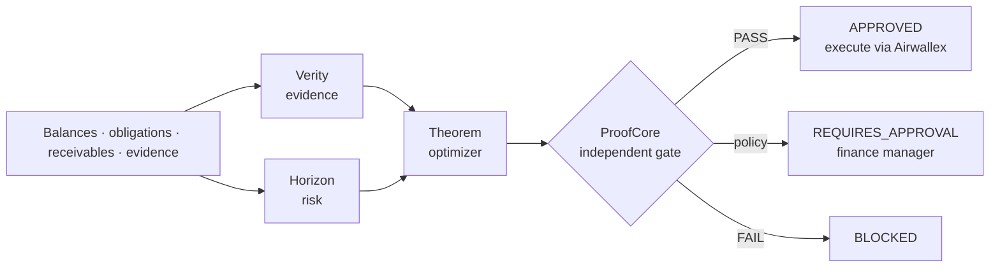

# VENTHORA

**Every financial decision, proven before execution.**

VENTHORA is an autonomous treasury agent for cross-border businesses, built on Airwallex. It decides which obligations to pay, convert for, defer or escalate when cash is limited. Before it acts, an independent verification gate proves that the action respects the reserve floor, company policy and the live bank state.

> Airwallex Agentic Banking Hackathon 2026 · Track **Treasury & Ops** · Starter Kit 01 **Adaptive Treasury Controller**

---

## The problem

A finance team holds USD and owes payroll, a SWIFT supplier in EUR and a vendor in GBP within the next 72 hours. A customer receipt they were counting on just slipped. Today someone re-runs a spreadsheet, guesses at FX, and hopes nothing gets paid twice.

Most AI agents can *recommend* a payment. VENTHORA verifies the evidence, quantifies the uncertainty, proves the action meets financial constraints, executes it through Airwallex, and verifies the outcome.

## How it works



| Engine | Answers | How |
|---|---|---|
| **Verity** | Which obligations and receipts are backed by trustworthy evidence? | Matches every obligation to its document and rejects settled records, unverified evidence and duplicate invoice fingerprints. A language model reads the inbox; the original Verity corpus, BM25 retriever and citation validator decide whether its claim is cited and pre-embargo |
| **Horizon** | What could change before money moves? | The original Horizon M0 scenario engine draws seeded joint EUR/USD and GBP/USD paths from ECB history; the p95 adverse 3-business-day move becomes the FX stress buffer. It also classifies receipts as reliable or not |
| **Theorem** | What is the best feasible plan? | Exact integer optimization (OR-Tools CP-SAT, or exact enumeration) with strict priority, FX conversion cost and SWIFT fees. It defers when a reliable receipt lands first and escalates otherwise. The original Theorem quant toolkit independently nets every conversion leg |
| **ProofCore** | Is this action safe to execute? | Recomputes post-action balances independently, then checks invariants, policy (local and OPA, which must agree), live Airwallex balances and the TigerBeetle ledger. Any failure blocks. This is SeismoForge's evidence-gate pattern, applied to finance |

The original engines are vendored unmodified, with SHA-256 provenance and a test that fails if they change: [`src/venthora/originals/PROVENANCE.md`](src/venthora/originals/PROVENANCE.md).

**Design rule (following the organizers' guidance):** amounts, limits, reserves, duplicate protection and state transitions live in code. The model reads unstructured text, compares evidence and explains. It never sets an amount or holds credentials.

## Demo: the Kit 01 story

The setting is a USD 22,500 treasury allocation with a USD 5,000 reserve floor. Five obligations in USD, EUR and GBP fall due within 72 hours ([`data/scenarios/kit01_baseline.json`](data/scenarios/kit01_baseline.json)), plus an inbox ([`data/inbox/kit01_inbox.json`](data/inbox/kit01_inbox.json)). The two later states are **generated by reading the inbox** (`scripts/make_scenarios.py`), not written by hand.

**1 · Day 1, initial plan (`kit01_initial`) → `APPROVED` autonomously.** Every Kit 01 behaviour appears in this one plan:

```text
Convert USD 4,353.95 -> EUR 4,012.85   minimum for the time-sensitive supplier (EUR 4,000 + 12.85 SWIFT fee)
Convert USD 3,175.00 -> GBP 2,500.00
Pay            PAYROLL-NOV         USD 8,000.00
Convert & pay  SHIPPING-UK         GBP 2,500.00  shipping invoice: non-payment halts operations
Convert & pay  SUPPLIER-EU         EUR 4,000.00
Reject         SUPPLIER-EU-RESENT  EUR 4,000.00  duplicate of SUPPLIER-EU (same invoice fingerprint)
Escalate       CONTRACTOR-US       USD 3,000.00  policy exception: payee bank details changed (cited email)
Defer          SAAS-USD            USD 1,200.00  cheapest obligation; reliable receipt RCV-ACME lands first
Autonomous FX limit USD 10,000 at forecast confidence 90%; conversions USD 7,528.95
```

**2 · Day 2, the customer emails that payment slips five days (`kit01_receipt_delayed`) → `REQUIRES_APPROVAL`.**
- Confidence is calibrated from the payer's history: Acme kept 6 of 8 promises counting this delay, so confidence goes from 90% to **70%**, with a 90% arrival window of 144–290 h.
- The autonomous limit scales with confidence (full at ≥90%, zero at ≤50%) and falls to USD 5,000. The **same conversion** now needs a finance manager.
- Only SAAS-USD changes (DEFER → ESCALATE); the other decisions stay locked.

**3 · The deposit lands (Airwallex `SETTLED`) → `APPROVED`.** Only SAAS-USD is recalculated (ESCALATE → PAY). The plan is then executed and reconciled.

**Which actions need a person:**

| Action | Needs a person when |
|---|---|
| FX conversion | the total exceeds the autonomous limit, which scales with forecast confidence (zero at ≤50%) |
| Payout to a payee with a policy exception (e.g. changed bank details) | always; never auto-paid |
| Obligation that cannot be funded before it is due | always (escalated) |
| Everything else in an `APPROVED` plan | never; executed within the mandate and proven by ProofCore |

## Quick start

Requires Python 3.11+.

```bash
python -m venv .venv
.venv/Scripts/python -m pip install -e ".[dev,solver]"     # Windows
# source .venv/bin/activate && pip install -e ".[dev,solver]"   # macOS/Linux
uvicorn venthora.api:app --reload
```

Open http://127.0.0.1:8000/docs and call `POST /api/scenarios/kit01_initial/plan`, then `POST /api/scenarios/kit01_receipt_delayed/plan`.

### Run the whole agent loop: `venthora-sandbox`

```bash
python scripts/import_ecb.py                                   # real FX history for Horizon (once)
python scripts/local_llm_server.py --port 8001                 # optional: local LLM (needs torch + transformers)
venthora-sandbox --fake --approve "Dana"                       # offline, in-process fake sandbox
venthora-sandbox --deposit 1000000 --approve "Dana"            # real Airwallex sandbox (.env credentials)
```

One command runs the steps below and writes a JSON run report to `data/runs/`:

1. Simulate the customer deposit.
2. Ground the scenario in live balances and rates.
3. Read the inbox: the LLM proposes, Verity verifies.
4. Apply Horizon's FX stress, plan with Theorem and prove with ProofCore.
5. Ask a finance manager to approve, if the plan needs it.
6. Execute on Airwallex.
7. Reconcile and confirm the reserve.

The LLM is any OpenAI-compatible endpoint (`MODEL_ENDPOINT`, `MODEL_NAME`, `MODEL_TOKEN`). `scripts/local_llm_server.py` serves a model from the local Hugging Face cache, by default `Qwen/Qwen2.5-0.5B-Instruct` on GPU. Without an endpoint, a deterministic lexicon reader is used. The model can only *propose* a delay. Code locates its quote in the email, and the original Verity validator checks the citation and the embargo. The delay figure must be written in the cited span. Unverified bad news lowers reliance on the receipt; it never makes a receipt earlier or more certain.

With Docker (includes a real OPA sidecar):

```bash
docker compose up --build
```

### Connect Airwallex sandbox

```bash
cp .env.example .env    # then fill AWX_CLIENT_ID and AWX_API_KEY (sandbox keys only, names as in the organizers' guide)
```

With credentials set, ProofCore cross-checks every plan against live sandbox balances (`GET /api/v1/balances/current`). `GET /api/airwallex/balances` shows them.

### Execute on the sandbox (Kit 01 end to end)

1. `POST /api/sandbox/deposits` `{"amount_minor": 1000000}`: simulate the customer receipt landing (needs `AWX_GLOBAL_ACCOUNT_ID`; list accounts with `GET /api/airwallex/global-accounts`).
2. `POST /api/scenarios/kit01_baseline/live-state`: obligations grounded in live balances and indicative rates.
3. `POST /v1/plans` with that state: review the plan and copy its `plan_hash`.
4. `POST /v1/executions` `{"state": ..., "plan_hash": ..., "approval": {"approver": "...", "role": "finance_manager"}}`. The `approval` is only needed for `REQUIRES_APPROVAL` plans.

Kit 03 on the same rails: add `--incident SUPPLIER-EU-NOV:BENEFICIARY_BANK_RETURNED` (with `--scenario kit03_incident`) to leave the transfer in flight, fail it with that type on the sandbox, and let the agent decide wait / replace / escalate under the duplicate lock.

The executor then runs these steps:

- **Preflight.** Re-plan, and refuse if the `plan_hash` differs from what was reviewed, the plan is `BLOCKED`, or the approver's role isn't allowed. Claim every payout before any money moves.
- **Quote.** Get a fresh single-use quote per conversion. Abort before booking if the quote exceeds the slippage limit or would breach the reserve floor at live balances.
- **Convert.** Book each quote once. The `request_id` is persisted *before* the call, and the quote is recorded as used.
- **Transfer.** Create the beneficiary from the approved payee registry ([`data/beneficiaries.json`](data/beneficiaries.json)), then the transfer (LOCAL or SWIFT).
- **Settle.** In the sandbox, move each transfer `SENT` → `PAID`. `SENT` is never treated as final.
- **Reconcile.** Re-read every transfer and the live balances. Expected = before + conversions − `amount_payer_pays`. The result is `COMPLETED` only when they match and the reserve holds.

If a response is lost, the operation is recovered by its `request_id` and never paid twice. A crashed run continues with `POST /v1/executions/{id}/resume`, which reuses the same `request_id`s. The same invoice cannot be paid by a second execution, even after Airwallex's 7-day `request_id` window has passed.

### Optional authorities

| Variable | Effect |
|---|---|
| `OPA_URL` | Policy is evaluated in OPA as well; any disagreement with local policy blocks |
| `TB_ADDRESS`, `TB_ACCOUNT_ID` | TigerBeetle ledger balance must also cover the plan (`pip install -e ".[ledger]"`) |
| `VENTHORA_NATIVE_LIB` | C++17 reserve gate ([`native/money_gate.cpp`](native/money_gate.cpp)) runs alongside Python |
| `VENTHORA_*_URL` | Plug in external Verity/Horizon/Theorem engines. They can only narrow what local checks allow ([contracts](docs/ENGINE_CONTRACTS.md)) |

Real FX stress: `python scripts/import_ecb.py`, then send `"use_ecb_stress": true`.

## API

| Method | Path | Purpose |
|---|---|---|
| `GET` | `/api/scenarios` | List demo scenarios |
| `POST` | `/api/scenarios/{id}/plan` | Plan a bundled scenario |
| `POST` | `/v1/plans` | Plan any `TreasuryState` |
| `GET` | `/api/audit` | Hash-chained decision log + integrity check |
| `GET` | `/api/status` | Solver and connected authorities |
| `GET` | `/api/airwallex/balances` | Live sandbox balances |
| `GET` | `/api/airwallex/global-accounts` | Sandbox Global Accounts (deposit targets) |
| `POST` | `/api/sandbox/deposits` | Simulate a customer deposit |
| `POST` | `/api/scenarios/{id}/live-state` | Scenario grounded in live balances and rates |
| `POST` | `/v1/executions` | Execute an approved plan on Airwallex and reconcile |
| `POST` | `/v1/executions/{id}/resume` | Resume an interrupted execution |
| `GET` | `/v1/executions/{id}` | Execution result and every operation with its `request_id` |
| `POST` | `/v1/incidents` | Kit 03: a sent transfer did not arrive; decide wait / replace / escalate under the duplicate lock |
| `GET` | `/v1/incidents`, `/v1/incidents/{id}` | Incident records (original, failure type, replacement, resolution) |

## Tests

```bash
pytest -q
ruff check src tests scripts
```

The 282 tests cover:

- **the scenario matrix** ([`docs/SCENARIO_MATRIX.md`](docs/SCENARIO_MATRIX.md), [`src/venthora/testing/matrix.py`](src/venthora/testing/matrix.py)): 136 real-world variants from the extreme to the normal (zero cash, USD 10 billion, one-cent and one-billion invoices, FX 0.0001 and 100, every Airwallex `failure_type`, 429 storms, lost responses, stale rates, prompt injection, hallucinating models, 100 sequential and 20 concurrent plans), each run through inbox → plan and proof → approval → execution on the fake sandbox → deposit / re-plan / Kit 03 incident, and judged against ten invariants (no crash, deterministic hash, reserve respected, pays only verified, reconciled, one PAID per invoice, unique request_ids, incident finality, decision-table match, latency). `python scripts/scenario_matrix.py` regenerates the report and writes the JSON log to `data/runs/matrix/`

- planning: the full Kit 01 flow, 40 randomized states that must never breach the reserve, CP-SAT vs exact-solver agreement
- real-sandbox findings: fee variance and learning, settled invoices never re-proposed, budget carried forward
- Kit 03 incident commander: the failure-type decision table, finality (in-flight is never replaced), replacement under the duplicate lock with a new request_id, the second SWIFT fee, resolution only once the original is recorded
- 72-hour simulation: breach probability, unfunded probability, policy tolerance gate, seeded reproducibility, Horizon joint paths, honest throughput accounting
- differentiators: incremental recalculation (locked decisions, full fallback, diff), counterfactual proof, AI challenger blocked or approved by the same gate
- original engines: unmodified-hash check, Horizon M0 stress flowing into the plan, Theorem leg netting, Verity accepting a cited delay and rejecting invented figures, invented quotes and embargoed email, lexicon fallback, and an end-to-end CLI run
- safety: duplicate-payment defense, remote engines that try to approve rejected invoices, fail-closed behavior, audit-chain tamper detection
- execution against a stateful fake Airwallex sandbox ([`tests/fake_airwallex.py`](tests/fake_airwallex.py)), which models single-use quotes, `duplicate_request_id`, the EUR 12.85 SWIFT fee, the transfer lifecycle and refunds:
  - end-to-end conversion and payout with reconciliation
  - approval rules and plan-hash binding
  - slippage abort before booking
  - no double payment across executions
  - lost-response recovery
  - failed payouts
  - crash and resume
  - sandbox-only enforcement

## Project structure

```text
src/venthora/
  domain/        typed state, integer money, post-action projection
  engines/       verity, horizon, theorem, remote adapters
  proofcore/     independent gate + policy (mirrored in policy/treasury.rego)
  gateways/      Airwallex (typed tools), OPA, TigerBeetle, native C++ gate
  execution/     executor, durable store (request_ids, payout claims, used quotes), live state
  orchestrator.py  the agent loop
  api.py         FastAPI app
data/scenarios/  Kit 01 demo scenarios
data/beneficiaries.json  approved payee registry (sandbox)
docs/            architecture, hackathon compliance, demo script
```

## Roadmap to submission (13 Nov 2026)

- [x] Airwallex execution tools: FX quote → conversion → transfer, single-use quotes, persisted `request_id`
- [x] Sandbox simulation: deposit + transfer transition; post-execution reconciliation
- [x] Human approval for `REQUIRES_APPROVAL` plans, bound to `plan_hash`
- [x] Run end to end against the real Airwallex sandbox: three cycles, see docs/SANDBOX_RESULTS.md
- [x] LLM evidence reader (local Qwen or any OpenAI-compatible model), verified by the original Verity validator
- [x] Kit 03 Payment Ops Incident Commander on the same rails (`--incident`)
- [x] 72-hour discrete-event reserve simulation (probabilistic proof) with a policy tolerance
- [ ] Treasury dashboard for the demo video

Status against the organizers' criteria: [docs/HACKATHON_COMPLIANCE.md](docs/HACKATHON_COMPLIANCE.md). Adversarial audit, oracle hunt and known limitations: [docs/AUDIT.md](docs/AUDIT.md). What is new, and what is not: [docs/INNOVATION.md](docs/INNOVATION.md). Real sandbox runs, findings and timings: [docs/SANDBOX_RESULTS.md](docs/SANDBOX_RESULTS.md).

## License

MIT. See [LICENSE](LICENSE).
